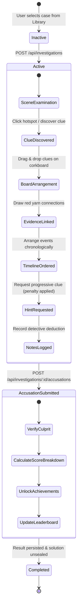

# MindMaze Architecture & Technical Design

## 1. System Architecture Overview

MindMaze is designed as a modular, decoupled full-stack detective game application. The architecture strictly separates the presentation layer, the REST API boundary, the game deduction engine, and the persistent storage layer.

```
┌──────────────────────────────────────────────────────────────┐
│                       CLIENT TIER                            │
│  HTML5 + Vanilla JS + Modern CSS (Custom Design System)      │
│  - Landing Page (index.html)                                 │
│  - Case Library (pages/cases.html)                           │
│  - Investigation Workspace (pages/workspace.html)            │
│    ├─ Crime Scene Hotspot Examiner                           │
│    ├─ Suspect Dossiers & Interrogations                      │
│    ├─ Interactive Evidence Board (Drag & Drop + SVG Links)   │
│    ├─ Timeline Chronology Arranger                           │
│    ├─ Detective Notebook (CRUD with color tags)              │
│    ├─ Progressive Hint Dispenser                             │
│    └─ Final Accusation Submission                            │
│  - Detective Dashboard & Stats (pages/dashboard.html)        │
│  - Hall of Fame Leaderboard (pages/leaderboard.html)         │
└───────────────────────────────┬──────────────────────────────┘
                                │ JSON over HTTPS / Fetch API
                                │ Bearer JWT Authorization
┌───────────────────────────────▼──────────────────────────────┐
│                    APPLICATION / API TIER                    │
│  Express.js REST Service                                     │
│  - Route Handlers & Controllers                              │
│  - JWT Authentication Middleware                             │
│  - Input Validation (express-validator)                      │
│  - IP Rate Limiting (express-rate-limit)                     │
│  - Error Handling & Sanitize Pipeline                        │
│  - Scoring & Deduction Engine (scoringService.js)            │
│    ├─ Accurate Culprit Verification (Culprit hidden in DB)   │
│    ├─ Timeline Sequence Validation                           │
│    ├─ Anti-Duplication Reward Guard                          │
│    ├─ Rank XP Scaling & Milestone Achievements               │
│    └─ Progressive Hint Penalty System                        │
└───────────────────────────────┬──────────────────────────────┘
                                │ Mongoose ODM
┌───────────────────────────────▼──────────────────────────────┐
│                        DATABASE TIER                         │
│  MongoDB (Document Store)                                    │
│  - Users Collection (credentials, ranks, XP, achievements)   │
│  - Cases Collection (clues, suspects, events, secret answer) │
│  - Investigations Collection (user progress, board, notes)   │
└──────────────────────────────────────────────────────────────┘
```

---

## 2. Directory Layout & Module Boundaries

The repository is structured to facilitate independent development branches for frontend developers, backend engineers, and integration testers:

```
MindMaze/
├── backend/                  # Backend service code
│   ├── config/               # Database and environment configurations
│   ├── controllers/          # Request handlers and response formatting
│   ├── middleware/           # Auth, validation, error handler, rate limiters
│   ├── models/               # Mongoose data schemas (User, Case, Investigation)
│   ├── routes/               # Express routing tables
│   ├── services/             # Game scoring, deduction algorithms, seed data
│   └── tests/                # Automated backend unit & integration tests
├── frontend/                 # Client assets and presentation
│   ├── assets/               # Visual assets, icons, scenes, suspect portraits
│   ├── css/                  # Styling tokens, utilities, and page stylesheets
│   ├── js/                   # Client modules (api.js, auth.js, ui.js, workspace.js)
│   ├── pages/                # Application pages (auth, cases, dashboard, leaderboard, workspace)
│   └── index.html            # Main landing page
├── docs/                     # Technical documentation & API specs
├── tests/                    # System & end-to-end test suites
├── .env.example              # Environment configuration template
├── .gitignore                # Git ignore rules for node_modules, logs, and secrets
├── package.json              # Project scripts and npm dependencies
└── README.md                 # Complete project setup and execution manual
```

---

## 3. Data Models & Schemas

### 3.1 User Schema (`backend/models/User.js`)
- `username`: String, unique, 3-20 characters, alphanumeric + underscores.
- `email`: String, unique, lowercase, validated format.
- `password`: String, hashed via `bcrypt` (12 rounds), `select: false` by default.
- `xp`: Number, detective experience points.
- `rank`: Enum string: `Rookie Detective` (0 XP) → `Junior Detective` (500 XP) → `Detective` (1500 XP) → `Senior Detective` (3000 XP) → `Chief Inspector` (5000+ XP).
- `casesCompleted`: Number.
- `totalScore`: Cumulative investigation score.
- `achievements`: Subdocument array containing unlocked badges.

### 3.2 Case Schema (`backend/models/Case.js`)
- `caseId`: Unique case identifier (e.g. `case-001`).
- `title`, `subtitle`, `description`, `setting`, `category`, `difficulty`.
- `crimeSceneDescription`, `crimeSceneImageUrl`.
- `suspects`: Array of suspects with motives, alibis, statements, and `isGuilty` flag (`select: false`).
- `clues`: Array of clues with discovery location, type, XP reward, and hotspot coordinates.
- `timelineEvents`: Canonical events with `correctOrder` integers.
- `hints`: Progressive hints with XP penalties.
- `solution`: Embedded subdocument (`select: false`):
  - `culpritId`: String matching the guilty suspect.
  - `explanation`: Detailed canonical solution narrative.
  - `keyEvidence`: Array of essential clue IDs supporting the conviction.

### 3.3 Investigation Schema (`backend/models/Investigation.js`)
- `userId`: ObjectId reference to `User`.
- `caseId`: String matching `Case.caseId`.
- `status`: `'active'` | `'completed'` | `'abandoned'`.
- `discoveredClues`: Array of discovered clue ID strings.
- `clueXpAwarded`: Array of clue IDs that already granted XP (anti-exploit guard).
- `connections`: Array of `{ clueIdA, clueIdB, label, createdAt }`.
- `boardPositions`: Map of `{ [clueId]: { x, y } }` coordinates for evidence board pin layout.
- `timelineSubmission`: `{ order: string[], isCorrect: boolean, score: number, submittedAt: Date }`.
- `notes`: Array of `{ title, content, color, createdAt, updatedAt }`.
- `hintsUsed`: Array of hint IDs requested by the player.
- `accusation`: `{ suspectId, reasoning, isCorrect, submittedAt, revealed }`.
- `score`, `xpEarned`: Calculated final metrics.
- `startedAt`, `completedAt`: Timestamps for duration bonus calculation.

---

## 4. Game Mechanics & State Machine



### 4.1 Anti-Exploit & Scoring Integrity
1. **Hidden Solution Protection**: The server never returns `solution`, `isGuilty`, or hidden clue coordinates in public case APIs. Evaluation happens exclusively inside `investigationController.submitAccusation`.
2. **Anti-Duplication XP Guards**: Clues award XP exactly once per investigation via `clueXpAwarded`.
3. **Accusation Finality**: Once an accusation is submitted, `status` becomes `'completed'`. Subsequent accusation submissions on the same investigation are rejected with HTTP 400.
4. **Data Isolation**: All investigation modification endpoints verify that `inv.userId.toString() === req.user._id.toString()`. Unauthorized requests receive HTTP 403 Forbidden.
